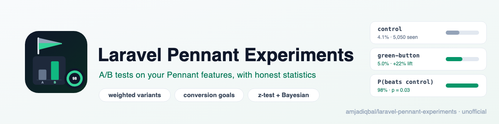
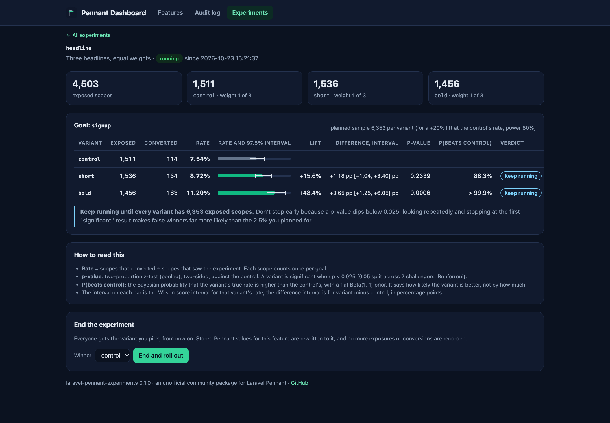

<p align="center">
  <picture>
    <source media="(prefers-color-scheme: dark)" srcset="art/banner-dark.png">
    
  </picture>
</p>

# Laravel Pennant Experiments: A/B testing for Laravel Pennant

A/B and multivariate experiments built on [Laravel Pennant](https://laravel.com/docs/pennant). Define an
experiment with weighted variants, and it becomes a Pennant feature whose value is the variant. Users,
teams, guests or any other scope get a sticky variant; you record who actually **saw** it and who
**converted**, from PHP or JavaScript; the results page runs a two-proportion z-test and a Bayesian
"probability to beat control", warns you when the sample is too small, and ends the experiment by rolling
the winner out to everyone.

> Unofficial community package. It is not made, endorsed or supported by Laravel. "Pennant" is the name
> of Laravel's feature flag package, which this package sits on top of.

Docs and demo: https://amjad.com.pk/laravel/packages/laravel-pennant-experiments

[](https://packagist.org/packages/amjadiqbal/laravel-pennant-experiments)
[](https://packagist.org/packages/amjadiqbal/laravel-pennant-experiments)
[](LICENSE.md)

<p align="center">
  
</p>

## What it does

- **Experiments are Pennant features.** `Experiments::define('checkout-button', ['control' => 50, 'green' => 50])`
  registers a Pennant feature that answers `'control'` or `'green'`. `Feature::value('checkout-button')`
  works as usual, and the [Pennant dashboard](https://github.com/amjadiqbal/laravel-pennant-dashboard)
  shows it like any other feature.
- **Weighted, multivariate.** Two variants or ten, any whole-number weights. The first is the control.
- **Sticky assignment for any scope.** A hash of the experiment and the scope picks the variant, so the
  same user, team or guest always gets the same one. With Pennant's database driver the first answer is
  also stored, so it stays put even if you change the weights later.
- **Guests too.** Signed-out visitors get a random id in a long-lived cookie. When they sign in, their
  exposure and conversions move to their user for every experiment the user has not seen yet, so they are
  counted once; for running experiments the user also keeps the guest's variant. See
  [Guests who sign in](#guests-who-sign-in).
- **Exposure tracking.** Only scopes that actually saw the variant are counted. `variant()` is for logic;
  `expose()` or `@variant` in Blade records the exposure.
- **Conversion goals** from PHP (`Experiments::convert()`) or JavaScript (`PennantExperiments.convert()`),
  counted once per scope and goal, and only for exposed scopes.
- **Statistics you can defend.** Two-proportion z-test with a confidence interval for the difference,
  Bayesian probability to beat control, Wilson intervals per rate, Bonferroni correction for several
  challengers, a minimum-data rule, and a planned sample size (set it, or derive it from the minimum
  detectable effect). No verdict before the data is there, and no "significant" before the plan is reached.
- **Winner rollout.** End the experiment from the results page or `php artisan pennant-experiments:end`:
  everyone gets the winner from then on, stored Pennant values are rewritten to it, and recording stops.
- **Bots and privacy signals.** When the participant comes from the current request, bots and requests
  with `DNT: 1` or `Sec-GPC: 1` get the control while it runs (the winner after it ends), no cookie, and
  are never counted. **Eligibility** rules
  keep anyone out of an experiment.
- Plain Blade, no Livewire, Filament or Nova. No telemetry, no network calls.

## Why this package

Pennant decides who gets a feature, but an A/B test also needs to know who saw it, who converted, and
whether the difference is real. The one Pennant-based package for this has had no commit since May 2025
and supports two variants only. This package is the
missing layer, in the spirit of Rails' [field_test](https://github.com/ankane/field_test), written for
Pennant from scratch.

## Requirements

- PHP 8.3+
- Laravel 12 or 13
- `laravel/pennant` 1.18+ (any driver; the database driver also stores assignments)

## Installation

```bash
composer require amjadiqbal/laravel-pennant-experiments
php artisan migrate
```

The migration adds three tables: `pennant_experiments` (run state and winner),
`pennant_experiment_exposures` and `pennant_experiment_conversions`. To publish the config, migrations or
views:

```bash
php artisan vendor:publish --tag=pennant-experiments-config
php artisan vendor:publish --tag=pennant-experiments-migrations   # then set run_migrations => false
php artisan vendor:publish --tag=pennant-experiments-views
```

## Define an experiment

In a service provider's `boot()`:

```php
use AmjadIqbal\PennantExperiments\Facades\Experiments;

Experiments::define('checkout-button', ['control' => 50, 'green' => 50], [
    'goals' => ['purchase', 'signup'],         // at least one; default ['conversion']
    'description' => 'Green buy button',
    'minimum_detectable_effect' => 0.10,      // plan for a +10% relative lift ...
    // 'sample_size' => 8000,                 // ... or set the per-variant sample yourself
    // 'eligible' => fn ($scope) => ! $scope?->is_admin,   // everyone else gets the control, uncounted
    // 'store' => 'database',                 // a Pennant store; default: Pennant's default
]);

Experiments::define('pricing-page', ['control', 'annual-first', 'monthly-first']); // equal weights
```

## Show a variant and record the exposure

In Blade, `@variant` records the exposure when it is evaluated:

```blade
@variant('checkout-button', 'green')
    <button class="btn-green">Buy now</button>
@else
    <button class="btn">Buy now</button>
@endvariant
```

`@elsevariant('checkout-button', 'blue')` works for more variants. In PHP:

```php
$variant = Experiments::expose('checkout-button');   // returns the variant and records the exposure
$variant = Experiments::variant('checkout-button');  // returns it without recording (for logic)
```

Both take an optional scope: `Experiments::expose('team-pricing', $team)`. Without one, the participant
is the signed-in user, otherwise the visitor cookie. To use something else by default (the current team,
say):

```php
Experiments::resolveScopeUsing(fn () => auth()->user()?->currentTeam);
```

> Pennant's own `Feature::value('checkout-button')` uses Pennant's default scope, which is `null` for
> guests. Use `Experiments::variant()` / `expose()`, or pass the scope, so each guest gets their own variant.

## Record conversions

```php
Experiments::convert('checkout-button', 'purchase');          // the current participant
Experiments::convert('checkout-button', 'purchase', $user);   // a given scope, e.g. from a job
```

A conversion counts once per scope and goal, and only if that scope was exposed first. After an
experiment ends, nothing more is recorded.

From JavaScript, add `@experimentsScript` to your layout, then:

```html
<button data-experiment-convert="checkout-button" data-experiment-goal="purchase">Buy</button>
<script>
    PennantExperiments.expose('checkout-button');               // for variants rendered in the browser
    PennantExperiments.convert('checkout-button', 'signup');
</script>
```

The endpoints (`POST /_experiments/expose`, `/_experiments/convert`, `GET /_experiments/variant/{name}`)
use the `web` middleware (CSRF) and a rate limit (`throttle:120,1`). The POST endpoints also check that the
`Origin` header (or, without one, the `Referer`) matches the request's scheme, host and port, so only your
own pages can record; behind a proxy, configure Laravel's trusted proxies so the request sees the public
host. The participant always comes from the session or the visitor cookie, never from the request body.

## Guests who sign in

On Laravel's `Login` event (with `merge_visitor_on_login`), the guest's visitor id is looked up and, for
each experiment:

- **the user has no exposure yet:** the guest's exposure and conversions are moved to the user (counted
  once). If the experiment is still running, the user is also given the guest's variant in Pennant, so they
  keep seeing it. For an ended experiment everyone gets the winner anyway.
- **the user was already exposed:** nothing moves. The user keeps their own variant and data, and the
  guest's rows stay as a separate participant (one person can then be counted twice, e.g. after using two
  devices).

## Bots, Do Not Track and Global Privacy Control

When the participant comes from the current request (you called `variant()`, `expose()` or `convert()`
without a scope, `@variant` without a scope, the JavaScript endpoints, or you passed a `Visitor`), the
request is left out if its user agent looks like a bot (`bot_pattern`) or it sends `DNT: 1` or
`Sec-GPC: 1` (`respect_privacy_signals`, on by default): it sees the control while the experiment runs (the
winner after it ends), no visitor cookie is set, and
nothing is recorded. This applies to signed-in users too. Scopes you pass yourself (a user from a job, a
team) are not checked, since there is no request to judge them by. If your own code calls `Experiments::participant()` or
`Experiments::visitor()` directly, that creates the visitor cookie whatever the request sends; the
package's own helpers (`variant()`, `expose()`, `convert()`, `@variant`, the JavaScript endpoints) don't.

## Read the results

Open `/pennant/experiments` (or the **Experiments** tab of the Pennant dashboard, see below), or run:

```bash
php artisan pennant-experiments:results                    # every experiment
php artisan pennant-experiments:results checkout-button    # one, per goal
```

For each goal and variant: exposed scopes, converted scopes, the rate with its Wilson interval, the
relative lift, the difference with its confidence interval, the z-test p-value and the probability to
beat control. The verdict is one of:

| Verdict | When |
|---|---|
| Too early | a variant has fewer than `min_exposures` (100) or `min_conversions` (10) |
| Keep running | there is a planned sample size and it is not reached yet |
| Better / Worse than control | the plan is reached and p < alpha |
| No significant difference | the plan is reached and p ≥ alpha |
| Better / Worse (no planned sample) | p < alpha but no plan was set: provisional |

### How the statistics work

- **z-test**: two-proportion z-test with the pooled standard error, two-sided. The confidence interval for
  the difference uses the unpooled (Wald) standard error.
- **Several challengers**: alpha is split between them (Bonferroni), so three variants against a control
  are each tested at 0.05 / 3.
- **Probability to beat control**: Beta(1 + conversions, 1 + non-conversions) posteriors with a uniform
  prior, using Evan Miller's exact closed-form sum. When the challenger has more than 20,000 conversions
  (the sum has one term per conversion), it switches to a normal approximation of the two posteriors.
  It says how likely the variant is better, not by how much.
- **Intervals** (the rate's Wilson interval and the difference interval) use the same adjusted level as
  the test: 95% with one challenger, 97.5% with two (0.05 / 2), and so on, so they are read at the same
  error rate as the p-value. (The difference interval uses the unpooled standard error and the test the
  pooled one, so in borderline cases one can just exclude zero while the other is just not significant.)
  At tiny samples the difference interval can run past ±100 points; the page then shows ±100 marked
  "(capped)".
- **Planned sample size** per variant (Fleiss, no continuity correction): `sample_size` if you set it.
  Otherwise, from `minimum_detectable_effect` and the **control's observed rate**, with the adjusted alpha
  and the configured power: it is empty until the control has a conversion, and it moves as the control's
  rate settles, so set `sample_size` yourself if you want a fixed target from day one.
- **No peeking claims**: a p-value is only valid at the sample size you planned for. Looking every day and
  stopping at the first p < 0.05 makes false winners far more likely than 5%, so before the plan is
  reached the page says "Keep running", whatever the p-value.

The statistics are unit-tested against textbook examples (the OpenIntro mammogram z-test, Fleiss'
sample size for 10% → 15%, exact Beta results) and independent numerical integration.

## End an experiment

On the results page, pick the winner and press **End and roll out**, or:

```bash
php artisan pennant-experiments:end checkout-button --winner=green
```

From then on every scope gets the winner, including scopes never seen before. Stored Pennant values for
the feature are rewritten to it (`Feature::activateForEveryone()`), and no more exposures or conversions
are recorded.

**Start over** (on an ended experiment, after a confirmation) resets it completely: its exposures and
conversions are deleted, its stored Pennant values are purged, and it runs again from now, so every scope
is assigned and counted afresh. The earlier results are gone; read or export them first.

When you are done, replace the experiment in code with the winning behaviour and remove the definition.
Experiments with data but no definition are listed at the bottom of the index page.

## With the Pennant dashboard

If [amjadiqbal/laravel-pennant-dashboard](https://github.com/amjadiqbal/laravel-pennant-dashboard) (v1.1+)
is installed, the results move next to it (`/pennant/experiments`, following its `path`) and its
navigation gets an **Experiments** tab. Neither package requires the other: without the dashboard,
nothing changes; with an older dashboard, the experiments pages still link back to it.

## Who can see the results

Two independent gates, each allowing only the `local` environment until you define it:

```php
use Illuminate\Support\Facades\Gate;

Gate::define('viewPennantExperiments', fn ($user = null) => $user?->is_admin);   // see results
Gate::define('managePennantExperiments', fn ($user = null) => $user?->is_admin); // end, start over
```

Defining only the view gate does not let anyone end or reset experiments outside `local`; define the
manage gate too.

`PENNANT_EXPERIMENTS_READ_ONLY=true` disables ending and restarting for everyone.

## Configuration

`config/pennant-experiments.php`:

| Key | Default | |
|---|---|---|
| `participant` | `user_or_visitor` | or `visitor` to always use the cookie id |
| `guard` | `null` | auth guard for the user |
| `cookie.name`, `cookie.minutes` | `pennant_experiments_visitor`, 1 year | the visitor cookie |
| `merge_visitor_on_login` | `true` | move a guest's data to the user on `Login` |
| `exclude_bots`, `bot_pattern` | `true` | bots get the control (the winner once ended), uncounted |
| `respect_privacy_signals` | `true` | `DNT: 1` / `Sec-GPC: 1` requests get the control (the winner once ended), uncounted |
| `statistics.alpha`, `.power` | `0.05`, `0.8` | |
| `statistics.min_exposures`, `.min_conversions` | `100`, `10` | per variant, before any verdict |
| `path`, `domain`, `middleware` | next to the dashboard, `null`, `['web']` | the results pages |
| `read_only` | `false` | |
| `tracking.enabled`, `.path`, `.middleware` | `true`, `_experiments`, `['web', 'throttle:120,1']` | JavaScript endpoints |
| `tracking.check_origin` | `true` | POSTs must come from your own scheme, host and port |
| `dashboard_tab` | `true` | the tab in the Pennant dashboard |
| `connection`, `tables` | default connection | the package's tables |

## Good to know

- **Weights after launch.** Changing weights changes the split for new scopes only (with the database
  driver). Don't change them mid-test unless you accept that the groups are no longer comparable.
- **Unique converters, not events.** A goal reached three times by the same scope counts once, which is
  what the z-test assumes (one trial per scope).
- **Privacy.** The visitor cookie is a random id, first-party, http-only, `SameSite=Lax`, and `Secure`
  when `session.secure` is on or the request is HTTPS. No IP addresses or user agents are stored. Do Not
  Track and Global Privacy Control are honoured (see above).
- **Array driver.** Assignment stays sticky through the hash; nothing is stored in Pennant, but exposures
  and conversions still are.

## Testing

```bash
composer test
```

## Need this built into your app, or something custom?

I build Laravel features end to end, from experiments and feature-flagged releases to the admin tools
behind them. If you want help running experiments properly, or you need something this package does not
do, [get in touch](https://amjad.com.pk/contact?utm_source=github&utm_medium=readme&utm_campaign=laravel-pennant-experiments).

## Support

- 🐛 **Bug or feature request**: [open an issue](https://github.com/amjadiqbal/laravel-pennant-experiments/issues)
- 🔒 **Security issue**: please report privately via GitHub's security tab

## Need this customised, or something built?

I'm available for custom development, package integration, and technical consulting.

[](https://www.upwork.com/freelancers/amjadkhatri)

## More packages

Part of a family of open-source packages. See [all of them](https://github.com/amjadiqbal?tab=repositories).

| | |
|---|---|
| [laravel-pennant-dashboard](https://github.com/amjadiqbal/laravel-pennant-dashboard) | A feature flag dashboard for Laravel Pennant |
| [laravel-driver-js](https://github.com/amjadiqbal/laravel-driver-js) | Product tours and onboarding for Laravel |
| [kiln](https://github.com/amjadiqbal/kiln) | Deploy-time OPcache control for Laravel |
| [laravel-mysql-advisor](https://github.com/amjadiqbal/laravel-mysql-advisor) | MySQL and MariaDB health checks with the SQL to fix each one |

## Changelog

See [CHANGELOG.md](CHANGELOG.md).

## License

MIT. See [LICENSE.md](LICENSE.md). This package is independent and not affiliated with Laravel.
